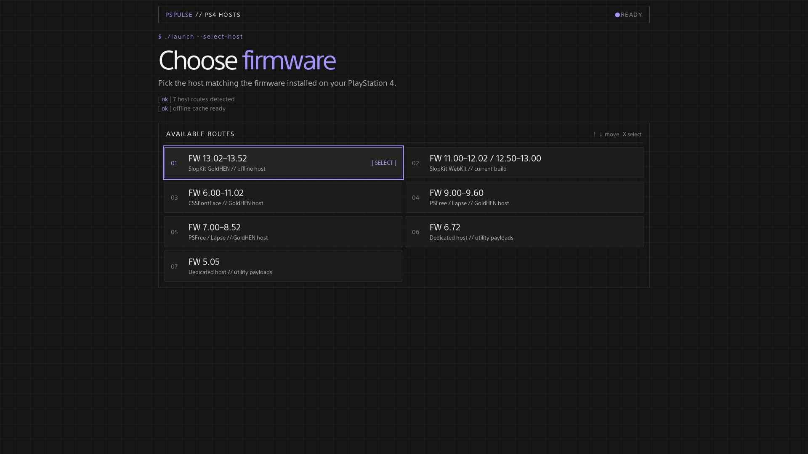

# PSPULSE // PS4 HOSTS

<p align="center">
  <strong>Centro de hosts para PS4 con prioridad sin conexión, flujos de exploit específicos por firmware e integración con GoldHEN.</strong>
</p>

<p align="center">
  
  
  
  
</p>



```text
$ ./launch --pspulse

[ ok ] 6 rutas de host detectadas
[ ok ] goldhen v2.4b18.12 / v2.4b18.10 preparado
[ ok ] caché sin conexión lista
[ ok ] navegación con mando habilitada
```

PlayStation Pulse es una colección autocontenida de páginas de host estáticas para PS4. Un punto de entrada, una elección de firmware y, después, el exploit y el flujo de GoldHEN correspondientes: diseñado para hosting local, caché sin conexión y el navegador de PS4.

> [!NOTE]
> Este proyecto está previsto para fines educativos, de preservación e investigación. Úsalo bajo tu responsabilidad. No está afiliado ni respaldado por Sony Interactive Entertainment.

<details>
<summary><b>$ cat contents</b></summary>

- [Qué proporciona este proyecto](#qué-proporciona-este-proyecto)
- [Flujos de firmware compatibles](#flujos-de-firmware-compatibles)
- [Cómo funciona el host](#cómo-funciona-el-host)
- [Versiones de GoldHEN](#versiones-de-goldhen)
- [Herramientas de payload](#herramientas-de-payload)
- [Caché sin conexión](#caché-sin-conexión)
- [Uso del host](#uso-del-host)
- [Sistema de diseño](#sistema-de-diseño)
- [Diseño técnico](#diseño-técnico)
- [Solución de problemas](#solución-de-problemas)
- [Seguridad y limitaciones](#seguridad-y-limitaciones)
- [Créditos y atribución](#créditos-y-atribución)

</details>

## Qué proporciona este proyecto

- Un router de firmware unificado con estilo de terminal en [`index.html`](./index.html).
- Páginas de host sin conexión dedicadas para PS4 firmware 5.05 y 6.72.
- Flujos de host PSFree/Lapse para firmware 7.00–8.52 y 9.00–9.60.
- Un flujo de host CSSFontFace UAF para firmware 6.00–11.02.
- Un flujo de investigación SlopKit WebKit para firmware 11.00–12.02 y 12.50–13.00.
- Recursos de GoldHEN v2.4b18.12 y v2.4b18.10 incluidos en el repositorio cuando el host admite ambos builds.
- Funcionamiento sin conexión basado en AppCache, con archivos de caché y manifest específicos por firmware.
- Utilidades de payload específicas por firmware en las ramas del host que las proporcionan.
- Un único sistema visual — estética de terminal oscura, acento violeta y foco compatible con mando — en todos los selectores, páginas de caché y páginas de exploit.

## Flujos de firmware compatibles

| # | Firmware | Punto de entrada | Flujo de exploit | GoldHEN | Payloads de utilidades |
|---|---|---|---|---|---|
| 01 | **13.02–13.52** | `1352/index.html` | SlopKit WebKit (GoldHEN) | `v2.4b18.12` | Solo payload de upstream |
| 02 | **11.00–12.02 / 12.50–13.00** | `1300/index.html` | SlopKit WebKit (Lapse / Poops) | `v2.4b18.12` | Solo payload de upstream |
| 03 | **6.00–11.02** | `css/version-selector.html` | CSSFontFace UAF + Lapse/NetCtrl | `stable` o `latest` | Sin menú separado |
| 04 | **9.00–9.60** | `900/version-selector.html` | PSFree + Lapse | Selector de versión | Incluidos |
| 05 | **7.00–8.52** | `700/version-selector.html` | PSFree + Lapse | Selector de versión | Incluidos |
| 06 | **6.72** | `672/index.html` | Host dedicado | Directamente en la página | Incluidos |
| 07 | **5.05** | `505/index.html` | Host dedicado | Directamente en la página | Incluidos |

El selector raíz almacena localmente el firmware seleccionado y dirige a la rama correcta. Usa siempre el host previsto para el firmware exacto instalado en la consola.

Protecciones contra carga previa: las cadenas de 1300 comprueban `getuid`/`setuid(0)` después del pivot de espacio de usuario y salen anticipadamente con `ALREADY JAILBROKEN` en lugar de volver a ejecutar el exploit de kernel si hay un jailbreak activo; las ramas PSFree de 700 y 900 consultan el endpoint de estado de GoldHEN (`http://127.0.0.1:9090/status`) durante 1,5 s y omiten el exploit cuando GoldHEN responde. Por tanto, volver a abrir un host después de una ejecución correcta es seguro por diseño.

## Cómo funciona el host

```text
$ ./launch --select-host

  index.html ──► router de firmware
                     │
      ┌──────────┬──┴─────┬────────┬────────┬────────┬────────┬─────────┐
      ▼          ▼        ▼        ▼        ▼        ▼        ▼         ▼
   FW 13.02  FW 11.00  FW 6.00  FW 9.00  FW 7.00  FW 6.72  FW 5.05
   -13.52    -13.00    -11.02   -9.60    -8.52    host     host
   selector  selector  selector selector selector
      │          │         │        │        │        │         │
      │          │      instalación de caché (build de payload)
      ▼          ▼        ▼        ▼        ▼        ▼         ▼
      └──────────┴────────┴───┬────┴────────┴────────┴─────────┘
                              ▼
                 cadena de exploit ──► HEN / GoldHEN + herramientas
```

El proyecto es intencionalmente estático. Las páginas HTML proporcionan la interfaz, los módulos JavaScript ejecutan la cadena de exploit específica de cada firmware, los archivos binarios proporcionan recursos de GoldHEN/kernel-patch/payload y los archivos AppCache mantienen disponible el flujo seleccionado después de la instalación inicial de la caché.

## Versiones de GoldHEN

El repositorio contiene dos opciones de GoldHEN cuando están admitidas:

- **GoldHEN v2.4b18.12** — build incluido en el repositorio y expuesto por los selectores.
- **GoldHEN v2.4b18.10** — build anterior incluido en el repositorio.

Las ramas 7.00–8.52 y 9.00–9.60 seleccionan un build de GoldHEN mediante su selector de versión y su página de caché. La rama CSSFontFace usa [`css/version-selector.html`](./css/version-selector.html), que dirige a:

- [`css/latest/index.html`](./css/latest/index.html) para v2.4b18.12;
- [`css/stable/index.html`](./css/stable/index.html) para v2.4b18.10.

## Herramientas de payload

La disponibilidad de payloads es específica de cada firmware.

### Hosts con payloads de utilidades

Según la rama seleccionada, las páginas del host proporcionan herramientas como:

- Servidor FTP;
- PS4Debug;
- App2USB;
- Copia de seguridad y restauración;
- Habilitar y deshabilitar actualizaciones;
- Instalación de AppCache;
- Bloqueador de historial;
- Descifrado de PUP;
- Renombrador de RIF;
- PSFree Fix en las ramas PSFree;
- WebRTE en las ramas que lo incluyen;
- Kernel Clock en el host de firmware que lo proporciona.

La lista exacta difiere entre 5.05, 6.72, 7.00–8.52 y 9.00–9.60. Los botones de payload cargan el binario seleccionado mediante el cargador de payloads existente del host y pueden requerir un receptor de payload compatible en la misma red.

### Alcance del host CSSFontFace

La rama CSSFontFace excluye deliberadamente el menú independiente de payloads de utilidades usado por otras ramas del host. El flujo de exploit CSSFontFace es intensivo en memoria por naturaleza, por lo que eliminar herramientas de payload adicionales ayuda a preservar el margen de memoria necesario para un exploit y un inicio de GoldHEN más estables. Su interfaz se centra en:

- salida del exploit con líneas de registro codificadas por color (información / error / depuración);
- selección de cadena `Lapse` o `NetCtrl`;
- cuenta atrás de `Auto Jailbreak`, `Jailbreak` manual y botón `Reload` para recuperarse tras un intento fallido;
- carga automática del build de GoldHEN seleccionado.

La implementación de CSSFontFace todavía contiene la etapa binaria interna necesaria para completar su flujo exploit/GoldHEN seleccionado. Esa etapa interna no es un payload de utilidad seleccionable por el usuario y no equivale al conjunto opcional de payloads de utilidad excluido de este host.

## Caché sin conexión

Todas las ramas del host usan recursos relativos y caché de aplicación del navegador. Los archivos de caché deben servirse desde las rutas esperadas por sus páginas de entrada; no cambies el nombre ni aplanes los directorios de firmware después del despliegue.

| Rama | Flujo de caché |
|---|---|
| **5.05** | `505/cache.manifest` está adjunto a la página del host y la página informa del progreso de instalación. |
| **6.72** | `672/cache.manifest` está adjunto a la página del host y la página informa del progreso de instalación. |
| **7.00–8.52** | Selecciona un build en `700/version-selector.html` y luego usa `cache.html` o `cache5.html` para instalar `PSPulse.cache` o `PSPulse5.cache`. |
| **9.00–9.60** | Selecciona un build en `900/version-selector.html` y luego usa `cache.html` o `cache5.html` para instalar `PSPulse.manifest` o `PSPulse5.manifest`. |
| **CSSFontFace** | Selecciona un build en `css/version-selector.html`; la página `stable` o `latest` elegida usa su propio `cache.manifest` con hashes SHA-256 por archivo. |
| **1300** | Abre `1300/index.html`; el build actual se almacena directamente en `1300/` e instala automáticamente su propio `cache.manifest`. |
| **1352** | Abre `1352/index.html` (GoldHEN `v2.4b18.12` para 13.02–13.52); la página instala automáticamente su propio `cache.manifest`; las actualizaciones de caché requieren tocar para recargar. |

Después de la primera instalación correcta de la caché, cierra y vuelve a abrir el navegador de PS4 cuando la página lo indique. Si una página sigue sirviendo un diseño o script antiguo, borra los datos del navegador del host y repite la instalación de caché.

El repositorio también incluye pequeños scripts generadores para reconstruir archivos de caché después de cambios en recursos. Cada vez que cambie un archivo en caché, regenera el manifest/cache correspondiente y verifica que todas las rutas relativas referenciadas estén disponibles desde el host desplegado.

## Uso del host

1. Sirve la raíz del repositorio mediante un servidor estático HTTP o HTTPS. No se debe esperar que el navegador de PS4 ejecute el flujo completo desde una URL `file://` no compatible.
2. Abre el [`index.html`](./index.html) raíz en el navegador de PS4.
3. Selecciona el rango de firmware exacto que coincide con la consola.
4. Si la rama seleccionada tiene un selector de versión de GoldHEN, elige **Latest** o **Stable** y espera a que termine la página de caché.
5. En la página del host, espera el mensaje de listo/estado antes de iniciar el exploit.
6. Después de que GoldHEN se haya cargado, usa solo las herramientas mostradas por esa rama del host.

En el host CSSFontFace, **Auto Jailbreak** está habilitado de forma predeterminada. Después de cargar la página, inicia una cuenta atrás de cinco segundos y luego ejecuta la cadena automáticamente; también puedes pulsar `Jailbreak` manualmente en cualquier momento. Durante la cuenta atrás aún puedes seleccionar `Lapse`/`NetCtrl` o desactivar Auto Jailbreak (la elección persiste en `localStorage`). En la primera visita, la cuenta atrás espera hasta que la instalación de AppCache se asiente; la cadena de exploit pesada nunca se ejecuta sobre una descarga de caché sin terminar, que era lo que antes detenía el progreso de la caché. Si la caché presenta errores, la página solicita un inicio manual en lugar de ejecutarse sin verificación.

La página CSSFontFace almacena la cadena seleccionada en `localStorage` bajo `exploitChain` y la preferencia de Auto Jailbreak bajo `autoJb`. El selector raíz y los selectores de GoldHEN también conservan localmente sus valores seleccionados para que el navegador pueda preservar la última elección entre cargas de página.

## Sistema de diseño

Todas las páginas — selector raíz, selectores de versión, instaladores de caché y hosts de exploit — comparten un mismo lenguaje visual, creado para un televisor visto desde un sofá y para un motor WebKit antiguo:

- **Paleta** — fondo casi negro `#151515`, paneles `#1c1c1c`/`#242424`, un único acento violeta `#a294ff`, error `#ff9b9b`, advertencia `#e1bd72`.
- **Estética de terminal** — tipografía monoespaciada, encabezados `$ ./launch`, líneas de arranque `[ ok ]`, separadores `//`, rutas numeradas.
- **Legible a distancia** — títulos de ruta grandes (19–24 px), encabezados de página de gran tamaño, nada por debajo de 12 px.
- **Prioridad al mando** — cada elemento interactivo es un elemento enfocable real con un doble anillo de foco (`2px bg + 4px accent`); navegación con teclas de flecha con respaldos `keyCode` heredados para builds antiguas del WebKit de PS4.
- **Sin sobrecarga** — sin frameworks, sin fuentes o imágenes externas, sin transiciones, sin keyframes, sin `backdrop-filter`; solo HTML estático, CSS inline y scripts ES5 pequeños.
- **Legibilidad del registro** — salida del exploit codificada por colores en el host CSSFontFace: información en acento, errores en rojo, depuración atenuada.

## Diseño técnico

### Selector raíz

La página raíz es un router de host estilo terminal, no un menú desplegable. Admite interacción con puntero y navegación con teclado o mando, almacena `selectedFirmware` y dirige a la rama de host correspondiente.

### Mantenimiento de AppCache

AppCache es tecnología de navegador heredada, pero forma parte del modelo de entrega sin conexión del host. Trata los archivos de caché como artefactos generados: después de cambiar un recurso HTML, JavaScript, binario o parche, actualiza la lista/hash de caché correspondiente y prueba por separado las rutas de primera carga y de carga desde caché.

## Solución de problemas

### Se carga la página incorrecta o una versión antigua

Borra los datos del sitio del navegador de PS4 para el host, cierra y vuelve a abrir el navegador y luego comienza desde el selector raíz. Confirma que el archivo de caché de la rama seleccionada contiene las rutas relativas actuales de los recursos.

### La caché nunca termina

Asegúrate de que el repositorio se sirve mediante HTTP/HTTPS, de que el manifest tiene la configuración/MIME correcta en el servidor y de que cada archivo listado está accesible en la ruta relativa exacta. Una AppCache obsoleta puede persistir después de actualizaciones normales; borra los datos del sitio antes de volver a intentarlo.

### El exploit no se completa

Verifica el firmware de la consola y la rama seleccionada, cierra pestañas del navegador no relacionadas y vuelve a intentarlo desde un estado limpio del navegador. En la página CSSFontFace, el inicio automático se ejecuta por sí solo después de que la caché se asienta; después de cualquier fallo usa `Reload` (la cuenta atrás se reinicia automáticamente) en lugar de volver a ejecutar la cadena sobre un estado no limpio. La fiabilidad del exploit puede variar según la memoria del navegador, el estado de la caché y las condiciones de la consola.

### Falta de memoria durante el exploit ("not enough RAM")

La cadena CSSFontFace solo tiene éxito cuando su heap spray se ubica correctamente; esto es una variabilidad de asignación de heap, no un error de interfaz, y varios intentos fallidos seguidos son variabilidad normal. Para maximizar la tasa de éxito:

1. Instala primero la caché y luego **cierra completamente el navegador de PS4** (no solo salgas de la página).
2. Vuelve a abrir el navegador, abre **solo** la página del host y no toques nada mientras se ejecuta.
3. Deja que la cuenta atrás del inicio automático se ejecute por sí sola; no muevas el cursor durante la ejecución.
4. Después de cualquier fallo usa **Reload** — la cuenta atrás se reinicia sola.
5. Si una cadena sigue fallando por falta de memoria en tu firmware, prueba la otra cadena (`Lapse` frente a `NetCtrl`); sus patrones de asignación son diferentes.

Aumentar los tiempos de espera no ayuda: la falta de memoria ocurre durante el spray y la página ocupa aproximadamente 10 KB frente a decenas de MB de asignaciones del exploit. No modifiques los tamaños de spray ni los intentos; son constantes ajustadas por investigadores en upstream.

### El navegador de PS4 se congela

JavaScript no puede recuperar de forma fiable un proceso de navegador que ha dejado de responder. Cierra y vuelve a abrir el navegador de PS4, y luego carga de nuevo el host correspondiente. Evita añadir bucles repetidos de reintento o recarga; pueden aumentar la inestabilidad.

### Un payload de utilidad no responde

Espera hasta que el host informe que el flujo de exploit/GoldHEN está listo. Confirma que el host seleccionado proporciona realmente la utilidad solicitada, que la PS4 y el receptor de payload están en la red esperada y que el receptor está escuchando en el puerto requerido. La rama CSSFontFace no proporciona botones de payloads de utilidad independientes.

## Seguridad y limitaciones

- Usa solo el host previsto para el firmware exacto de la consola.
- No interrumpas la consola mientras se ejecuta un exploit, la carga de GoldHEN, un payload o una operación del sistema.
- Mantén una vía de recuperación segura y copias de seguridad actualizadas antes de usar utilidades de copia de seguridad, restauración o relacionadas con el sistema.
- No uses páginas de exploit para acceso a PSN u otros servicios en línea.
- No asumas que un payload es inocuo solo porque está incluido localmente; revisa qué hace cada utilidad antes de cargarla.
- El flujo CSSFontFace es especialmente sensible a la memoria disponible del navegador; excluir payloads de utilidades opcionales es una compensación intencional de estabilidad.
- La rama 11.00–12.02 / 12.50–13.00 es una ruta de investigación sin garantía de estabilidad; 12.03–12.49 no tienen un fallo funcional en upstream.
- Ningún host puede garantizar resultados idénticos en cada consola, build de navegador, estado de caché o configuración de red.

---

```text
$ exit

PSPULSE // colección de hosts para PS4 sin conexión
```
